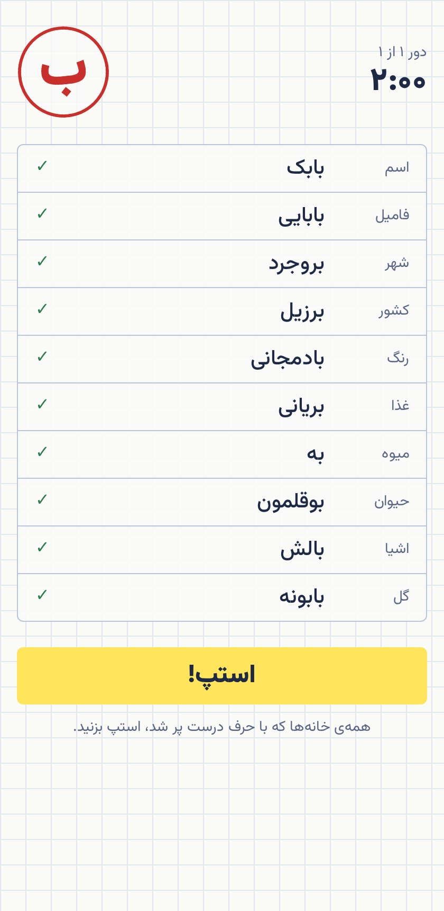
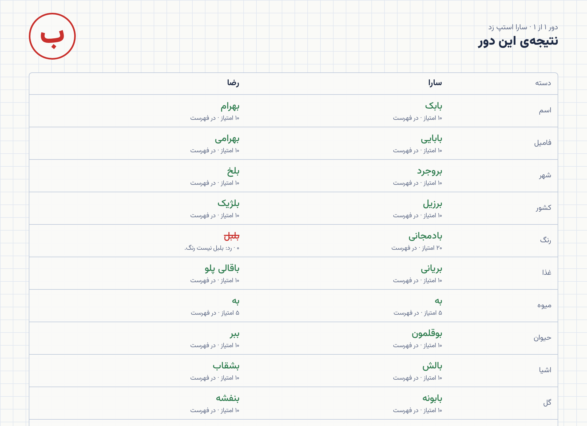

# esm-famil · اسم فامیل

Online multiplayer version of the Persian word game اسم فامیل (the Iranian Scattergories). One
player opens a room, friends join with a 4-letter code, a random letter is drawn, everyone fills in
a word per category, and the first to finish calls «استپ». The server checks every answer and
scores the round.

<p>
  
  
</p>

**Play:** https://esm.amirradjou.com. The client is a static site, but the game server runs on my
own computer, so the game only works while that machine is on. If it says it can't connect,
self-host (below) or try again later.

## Run it yourself

Needs Node 22+ and pnpm.

```sh
git clone https://github.com/amirradjou/esm-famil.git && cd esm-famil
pnpm install
pnpm build
pnpm start          # http://localhost:3000, API and web app from one process
```

Open it in two browser windows to play against yourself. `PORT` changes the port. Or use
`docker compose up --build`. For development, `pnpm dev` serves the web app on :5173 and the API
on :3000.

Answers are checked against a bundled word list (about 4,700 Persian words in 12 categories) with no
setup. To also have a language model rule on words the list doesn't know, copy `.env.example` to
`.env` and set `LLM_PROVIDER=ollama` (local) or `claude` (needs an API key).

## How it works

- `packages/shared`: scoring rules and the message types shared by both sides.
- `apps/server`: Fastify and socket.io. Rooms live in memory; a room is a small state machine
  (lobby, round, review, final).
- `apps/web`: React, Vite and Tailwind, right-to-left.
- Scoring per cell: 10 for a valid answer nobody else wrote, 5 if someone else wrote it too, 0 for
  empty or invalid. The host can flip any verdict in the review screen.
- Approved answers are saved under `DATA_DIR/learned/`, so the word list grows with play.

More in [docs/architecture.md](docs/architecture.md) and [docs/self-hosting.md](docs/self-hosting.md)
(Netlify, Tailscale Funnel, systemd).

```sh
pnpm test      # unit tests
pnpm lint      # prettier and typecheck
```

## License

MIT
